# Rediscovering the Standard Model with CERN Open Data

A data science project on **real CMS and ATLAS data** from [CERN Open Data](https://opendata.cern.ch).
It has three parts, from simple physics to big data and machine learning:

| Part | Dataset | What it does | Headline result |
|---|---|---|---|
| **1. Particle rediscovery** | CMS 2011 DoubleMu, 100k events | Computes the dimuon invariant mass from raw four-momenta and fits the peaks | Z boson at **90.77 ± 0.04 GeV**, J/ψ at **3.0931 GeV** |
| **2. Big data pipeline** | CMS 2012 DoubleMuParked, **61.5M events / 2.2 GB** | Parallel out-of-core ETL (uproot + awkward → Parquet), then Dask **and Spark SQL** analytics | **61.5M events in ~21 s** (2.9M events/s, 8 workers, <800 MB per worker) |
| **3. Higgs ML** | ATLAS Higgs ML Challenge 2014, 818k events | XGBoost H→ττ signal vs background classifier, scored with the official Kaggle protocol | **AMS 3.69** on the private test set (2014 winner: 3.806) |

---

## Part 1: Rediscovering particles in 100k CMS collisions

When a particle decays into two muons (μ⁺μ⁻), the **invariant mass** of the pair equals the mass
of the parent particle:

$$M^2 = (E_1 + E_2)^2 - \lVert \vec p_1 + \vec p_2 \rVert^2$$

Computing it for every event and plotting a histogram makes the known particles appear as peaks.

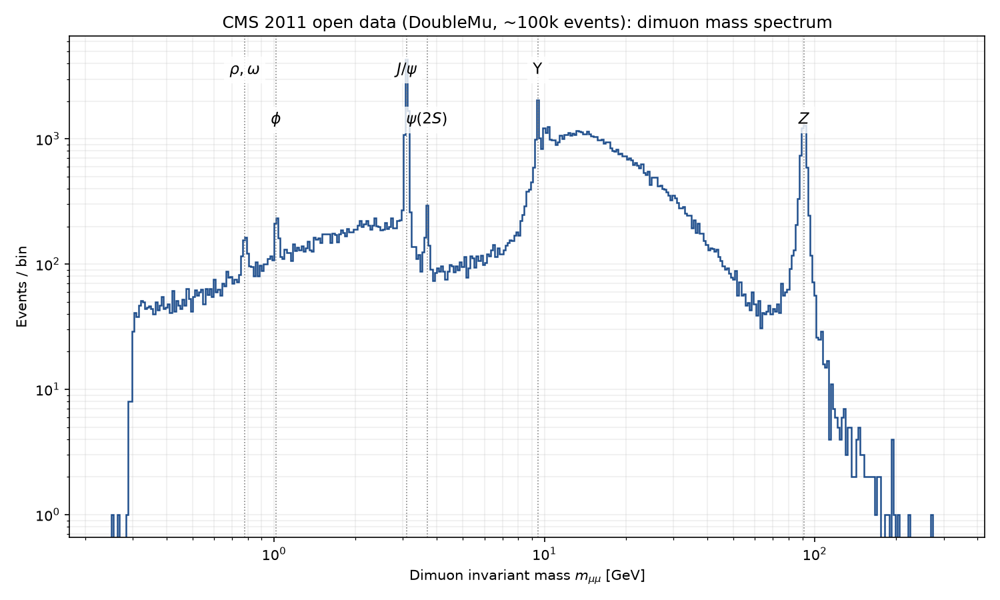

The mass I compute matches the value CMS stored in the file: median difference 8×10⁻⁵ GeV,
and 99.9% of events agree within 0.013 GeV. The ~200 larger differences are light, fast muon
pairs, where E² − p² is a small difference of large numbers, so the 4-decimal rounding in the CSV
gets amplified. I then fit two of the peaks:

| Z boson: Voigt fit (Breit-Wigner ⊗ Gaussian resolution) | J/ψ meson: Gaussian fit |
|---|---|
| 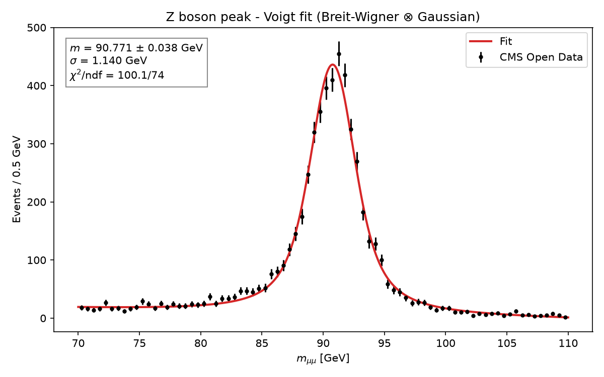 | 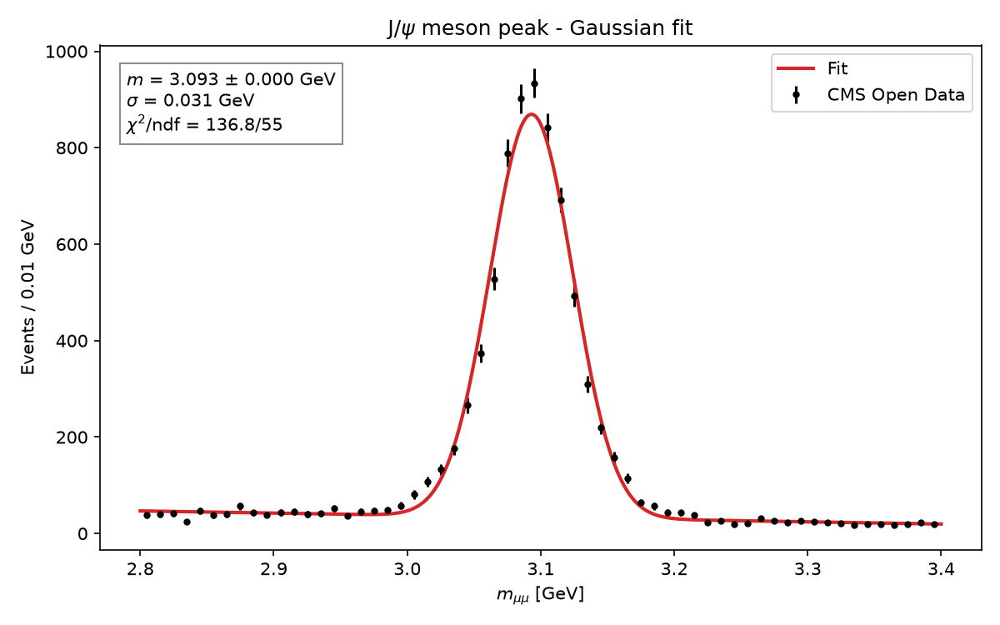 |

The fitted Z mass (90.77 GeV) is about 0.45% below the PDG value (91.19 GeV). That's expected:
this simplified dataset has no muon momentum-scale calibration applied, and that calibration is
exactly what a real analysis would add next.

## Part 2: A parallel pipeline over 61.5 million collisions

This is the classic CMS dimuon spectrum, rebuilt from **61.5 million real 2012 collisions** on a laptop:

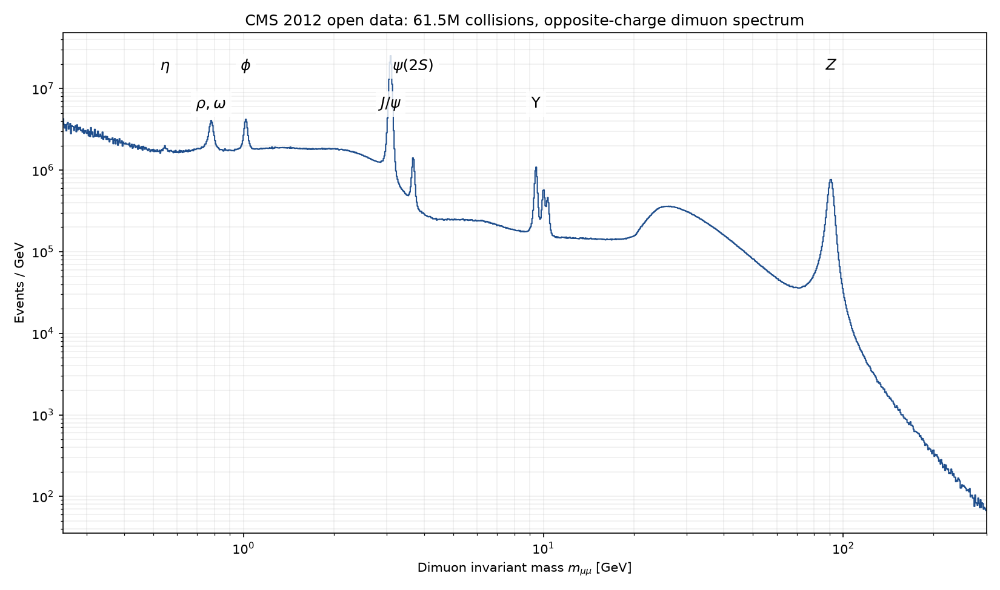

With 24M dimuon candidates, the statistics are high enough to separate the three Υ states,
bound states of a bottom quark and its antiquark, only ~0.3–0.6 GeV apart:

| Υ(1S), Υ(2S), Υ(3S) resolved | Selection cut-flow |
|---|---|
| 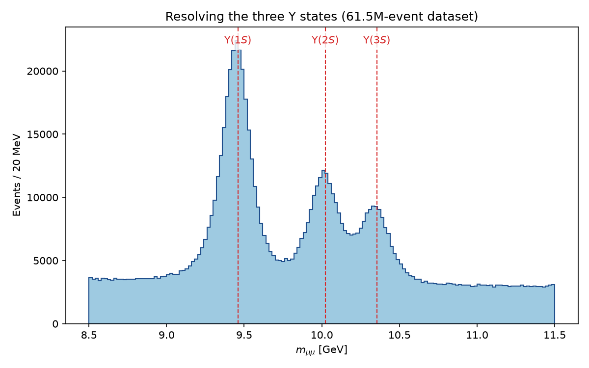 | 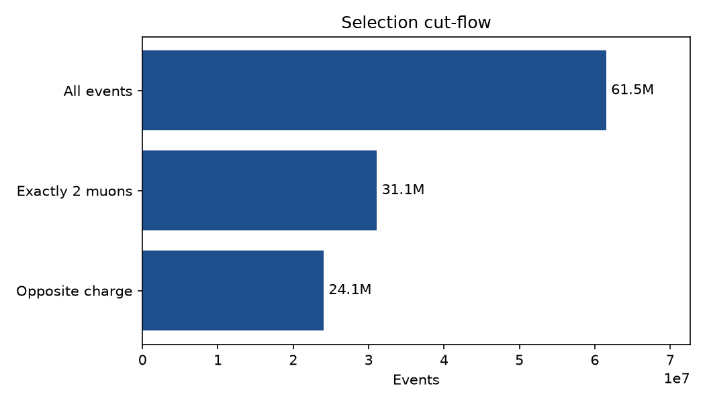 |

**Performance** (8-worker process pool, laptop, see [`results/bigdata_pipeline.json`](results/bigdata_pipeline.json))

| Metric | Value |
|---|---|
| Input | 2.24 GB ROOT, 61,540,413 events, jagged muon arrays |
| ETL wall time | **20.9 s**, about **2.9 million events / s** (input file already in the OS disk cache) |
| Peak memory per worker | 770 MB (bounded by the 1M-event chunk size, not the dataset size) |
| Output | 24.1M selected dimuon candidates in 0.85 GB of zstd Parquet |
| Dask analytics (histogram + window counts + aggregates) | **1.3 s** over 24M rows |
| Candidates in the J/ψ / Υ / Z windows | 2.26M / 0.64M / 4.85M |

The broad bump at 20–40 GeV isn't a particle. It comes from the trigger: the "parked" dimuon
trigger only kept events whose muons passed momentum thresholds, which sculpts the spectrum there.

**Design**

```
 2.2 GB ROOT file (jagged arrays, 61.5M events)
        │  split into 1M-event chunks
        ▼
 ┌──────────── process pool (map) ────────────┐
 │ uproot read → awkward selection:           │
 │   exactly 2 muons, opposite charge         │
 │ → vectorised invariant mass                │
 │ → zstd-compressed Parquet part file        │
 └────────────────────────────────────────────┘
        │  columnar, analysis-ready dataset
        ▼
 Dask: per-partition histograms (map) → sum (reduce),
       mass-window counts, aggregates — computed in one pass
```

* **Out-of-core:** no process ever holds the full dataset. Memory use is bounded by the chunk size.
* **Columnar and vectorised:** no Python loop over events. Selection and kinematics are array operations.
* **Numerically careful:** the mass is computed in float64 and stored in float32. An earlier float32-only
  version mis-computed ~14k light-pair masses through cancellation in E² − p². The fix was verified by the
  smallest mass coming out at 0.2113 GeV, exactly 2 × the muon mass, the physical threshold.
* **Re-usable output:** later analyses read the small Parquet dataset instead of the raw ROOT file.

### Part 2b: the same analysis in Apache Spark SQL

Spark can't read CERN's ROOT format natively. The Parquet output of the ETL stage is the bridge
into the standard big data ecosystem. [`src/04_spark_sql.py`](src/04_spark_sql.py) registers the
dataset as a SQL table and runs the whole analysis as plain SQL. The same queries run unchanged on
a multi-node cluster, Databricks, or CERN's SWAN service.

```sql
-- Detector physics in SQL: is the Z peak narrower when both muons hit the central barrel?
WITH z AS (
  SELECT mass,
         CASE WHEN ABS(eta1) < 1.2 AND ABS(eta2) < 1.2  THEN 'barrel-barrel'
              WHEN ABS(eta1) >= 1.2 AND ABS(eta2) >= 1.2 THEN 'endcap-endcap'
              ELSE 'barrel-endcap' END AS region
  FROM dimuons WHERE mass BETWEEN 86 AND 96)
SELECT region, COUNT(*) AS candidates, AVG(mass) AS mean_mass, STDDEV(mass) AS stddev_mass
FROM z GROUP BY region ORDER BY stddev_mass;
```

| Region (both muons) | Z candidates | Spread of Z peak |
|---|---|---|
| barrel-barrel | 1,419,071 | **2.07 GeV** |
| barrel-endcap | 1,960,932 | 2.18 GeV |
| endcap-endcap | 751,335 | 2.32 GeV |

The SQL confirms a real detector effect: muons in the central barrel are measured more precisely,
so the Z peak is about 11% narrower than for muons in the forward endcaps.

| Histogram computed inside Spark (`GROUP BY` bin, only ~600 rows leave Spark) | Resolution by detector region |
|---|---|
| 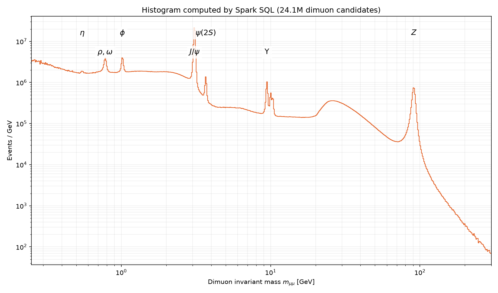 | 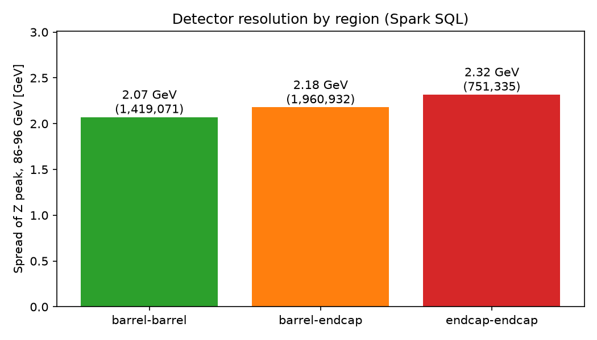 |

**Data validation found broken records.** Sorting by mass showed "dimuons" heavier than 100 TeV,
with muon momenta far above the 4 TeV beam energy and η = 11.5, which is outside the detector.
A data-quality query counts them across all 24M candidates:

| Check | Records | Verdict |
|---|---|---|
| muon p<sub>T</sub> > 4 TeV (above the beam energy) | 977 | impossible |
| muon \|η\| > 3 (far outside tracker and muon chambers) | 2,663 | impossible |
| **clearly unphysical, total** | **3,632** | broken reconstructions |
| pair mass > 8 TeV (above the collision energy) | 14 | impossible |
| muon \|η\| > 2.4 (beyond the muon chambers) | 169,839 | suspicious: the tracker reaches \|η\| = 2.5, so many are edge cases, not errors |

This reduced dataset doesn't include the muon-ID and track-quality variables a full CMS analysis
would cut on, so these kinematic checks are a first line of defense. Even after them, a few
multi-TeV "dimuons" remain, almost certainly very straight, badly measured tracks. All seven queries run in about 40 s on a laptop
([`results/spark_sql.json`](results/spark_sql.json)).

## Part 3: Finding the Higgs boson with machine learning

The [ATLAS Higgs ML Challenge](https://opendata.cern.ch/record/328) asked how well ML can separate
**H → ττ** signal events from background (Z → ττ, top-pair, W). The metric is the
**Approximate Median Significance (AMS)**, a proxy for discovery significance in σ.

I followed the original challenge protocol so the score is directly comparable to the 2014 leaderboard:
train on the 250k training set, choose the selection threshold on a validation split only, and
score once on the 450k-event private test set.

| Model | Private AMS | AUC |
|---|---|---|
| Logistic regression (baseline) | 2.16 | 0.895 |
| Official TMVA benchmark | 3.20 | – |
| Official MultiBoost benchmark | 3.40 | – |
| **XGBoost + angular features (this project)** | **3.69** | **0.936** |
| Rank 45 of 1,785 teams (XGBoost) | 3.72 | – |
| 2014 winner, G. Melis (ensemble of deep neural networks) | 3.806 | – |

Leaderboard numbers are from the challenge paper: Adam-Bourdarios et al.,
[*The Higgs boson machine learning challenge*, PMLR 42 (2015)](https://proceedings.mlr.press/v42/cowa14.html).

Feature engineering: the raw φ angles are replaced by rotation-invariant Δφ between the τ, lepton,
jet and missing energy, because physics is symmetric under rotation around the beam axis.

| Classifier output | Choosing the threshold |
|---|---|
| 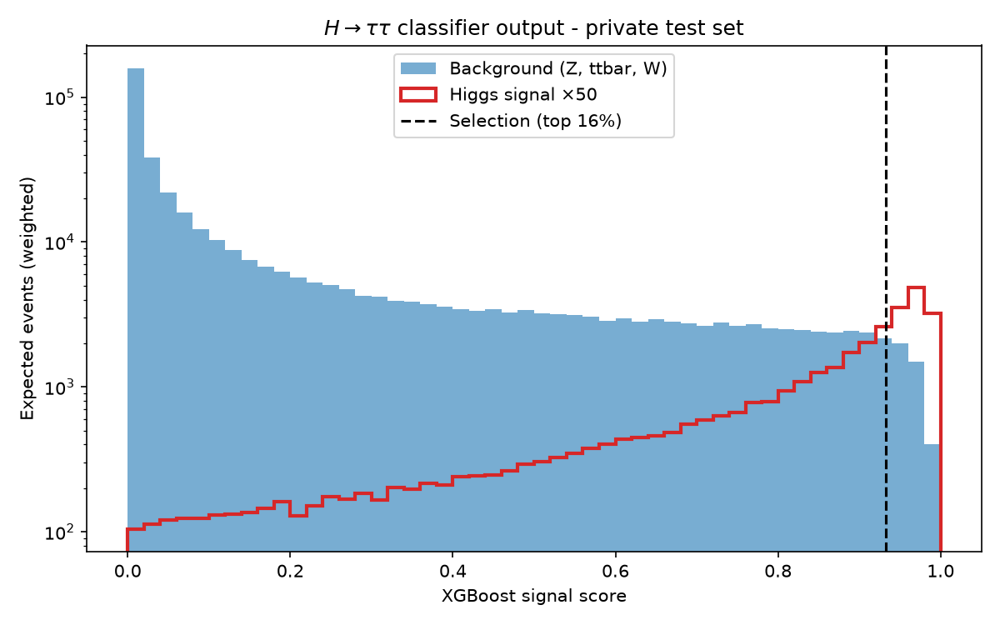 | 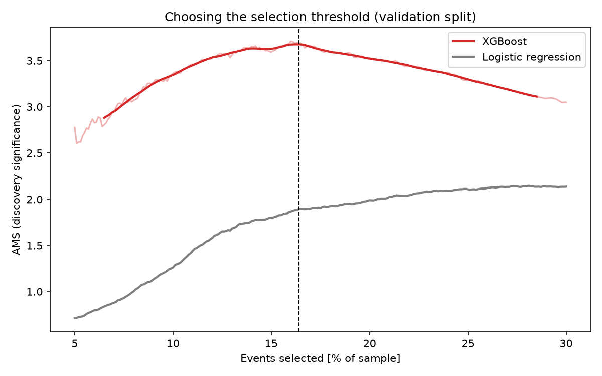 |

| ROC | Most important features |
|---|---|
| 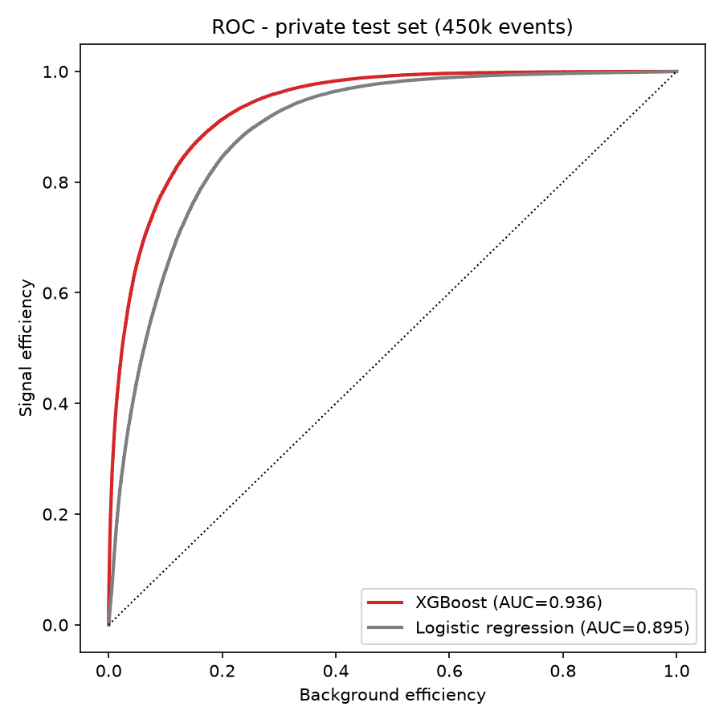 | 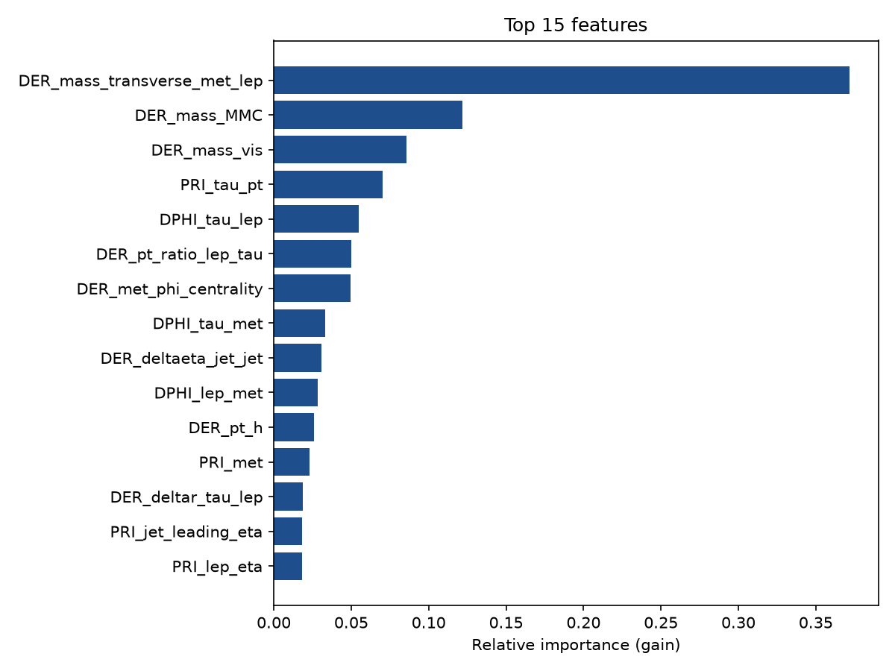 |

The model's top features are the reconstructed masses (`DER_mass_MMC`, `DER_mass_transverse_met_lep`,
`DER_mass_vis`). It learned the same thing physicists use by hand: a Higgs decay leaves a mass peak.

---

## Reproduce

```bash
pip install -r requirements.txt
python src/00_download_data.py --all     # ~2.3 GB (drop --all to skip Part 2's file)
cd src
python 01_dimuon_2011.py
python 02_bigdata_pipeline.py
python 04_spark_sql.py           # needs Java 17
python 03_higgs_ml.py
```

Figures go to `figures/` and numeric results go to `results/*.json`.

## Data and credits

* CMS Collaboration, *Dimuon datasets derived from Run2011A*, [CERN Open Data record 545](https://opendata.cern.ch/record/545)
* CMS Collaboration, *DoubleMuParked 2012 NanoAOD reduced on muons*, [record 12341](https://opendata.cern.ch/record/12341)
* ATLAS Collaboration, *Higgs Boson Machine Learning Challenge 2014*, [record 328](https://opendata.cern.ch/record/328)
